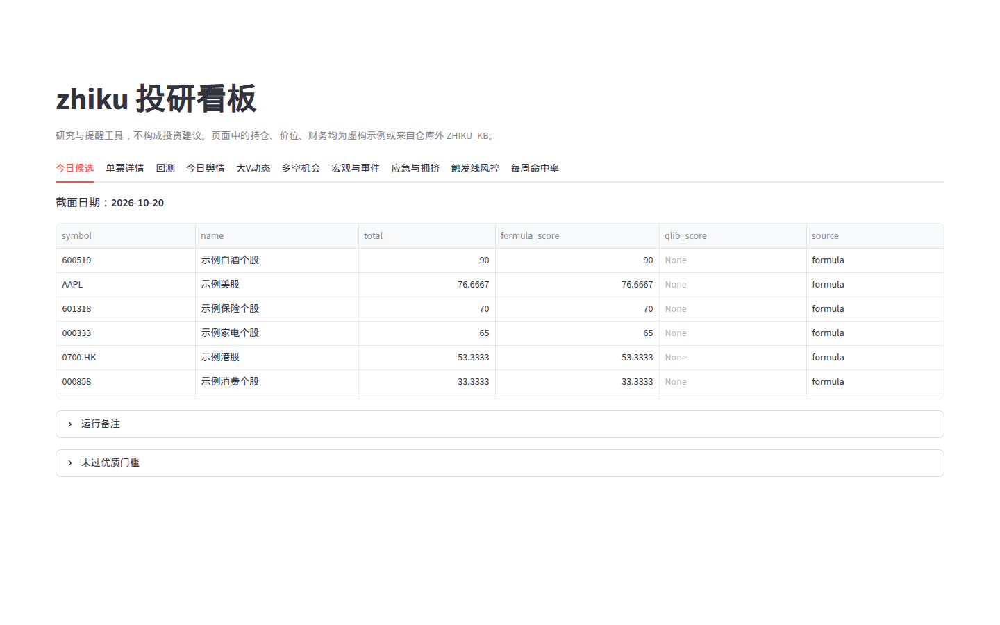
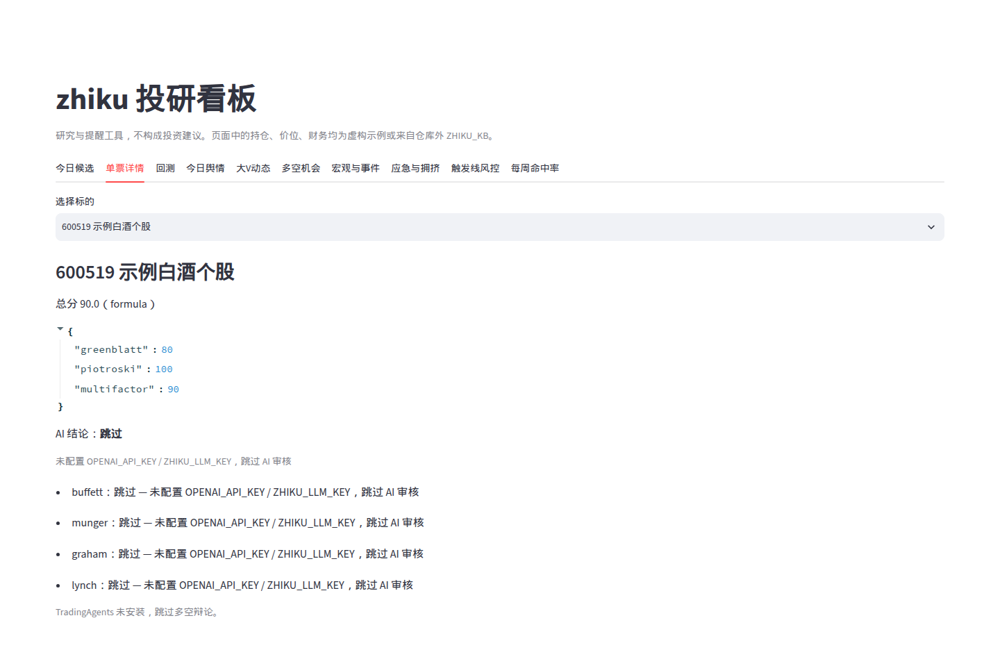
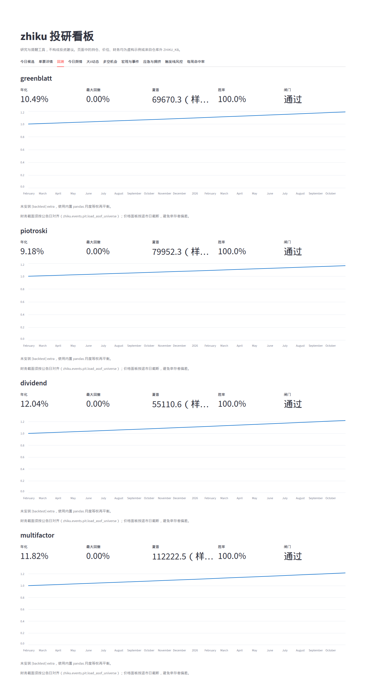
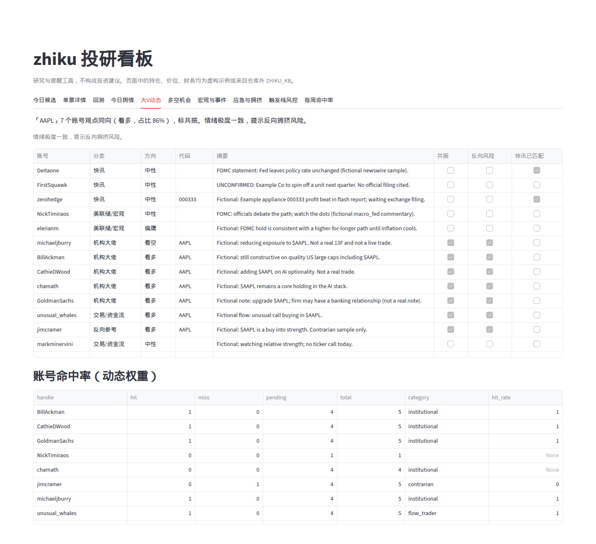
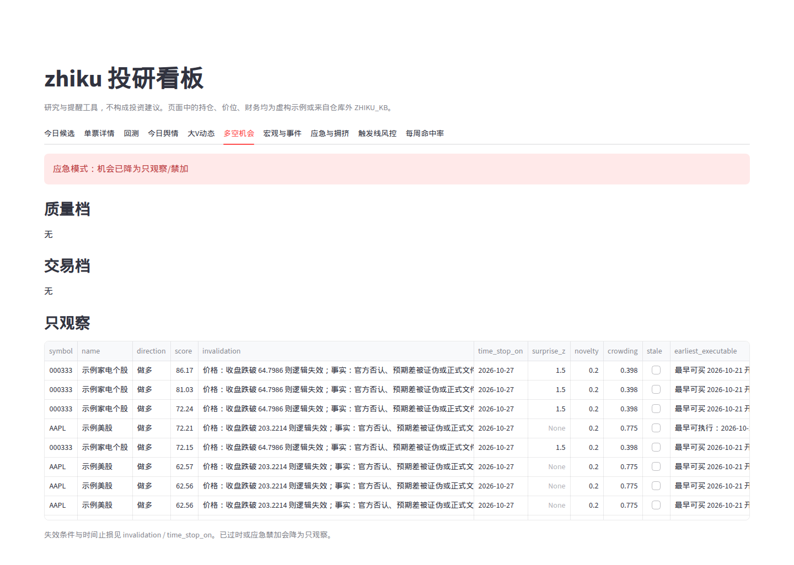
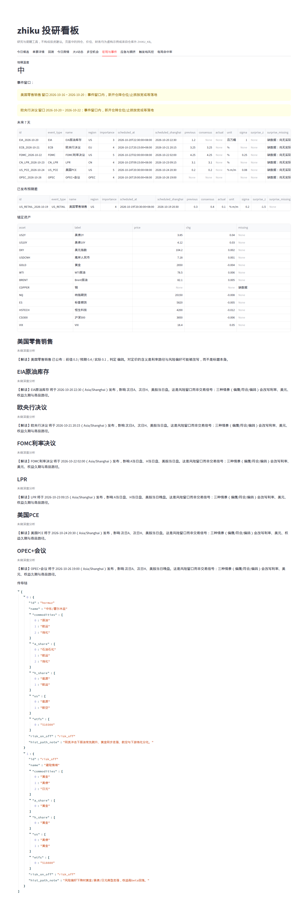
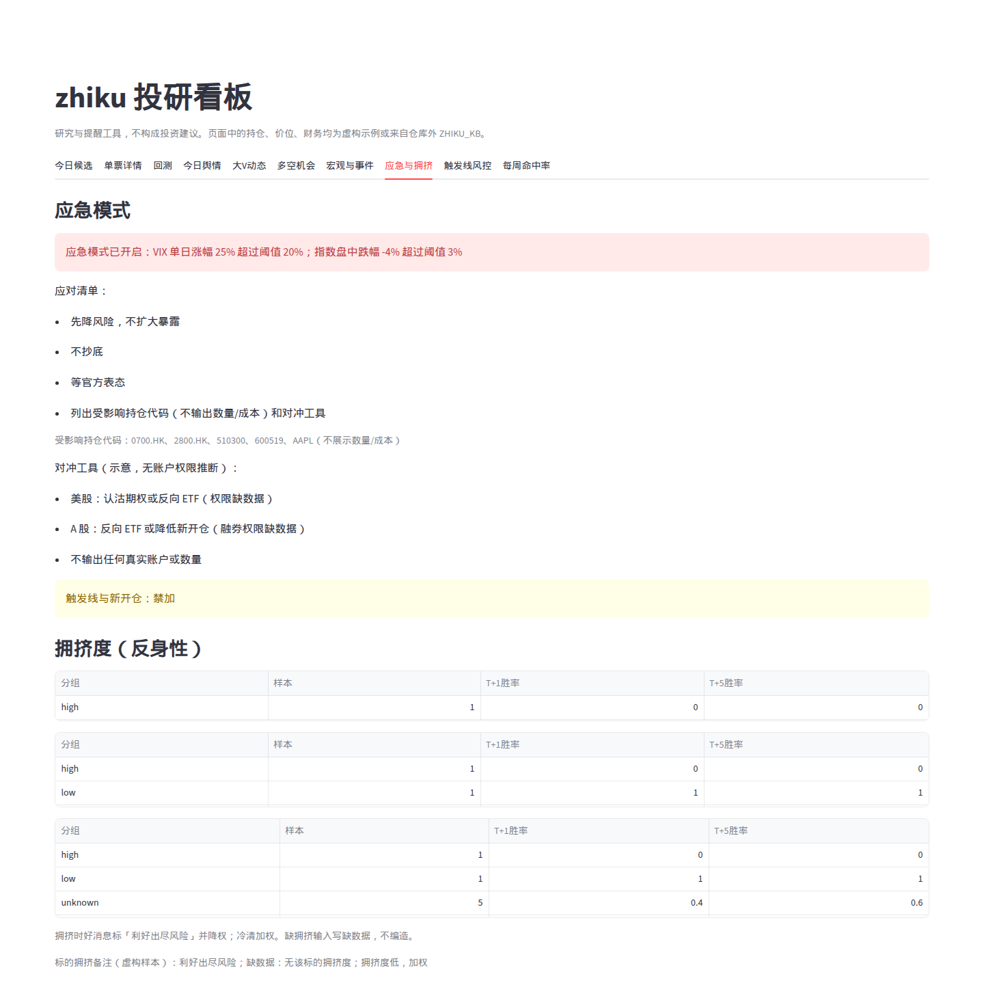
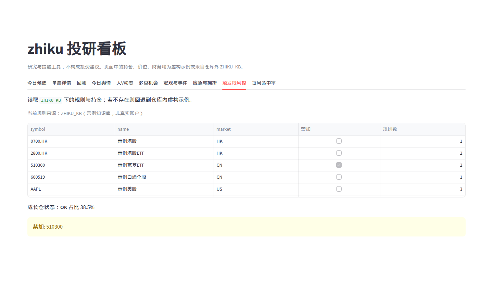
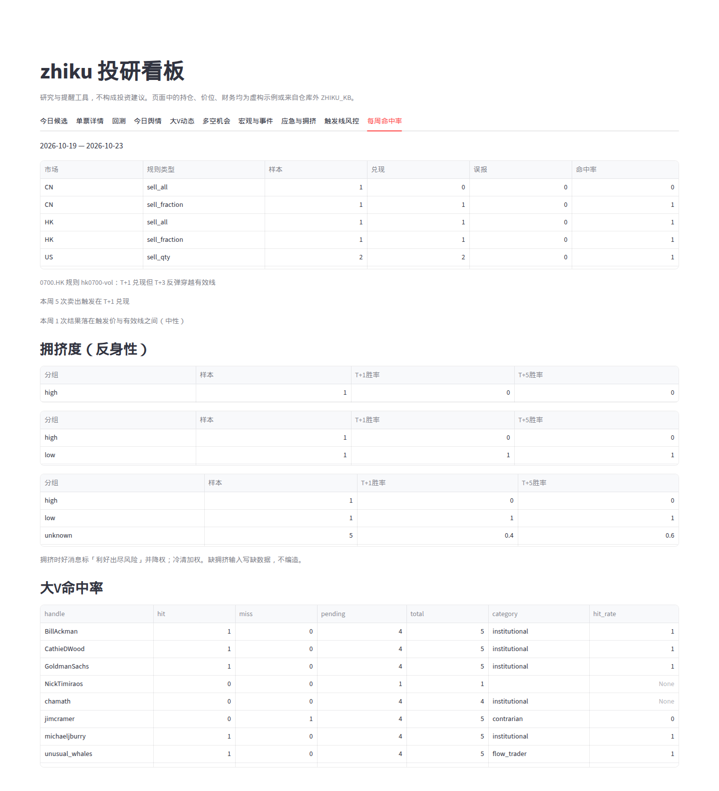

# zhiku

把个人投研流程代码化的本地工具：选股公式 → 因子打分 → 回测闸门 → 新闻/宏观**分析**（不是标题搬运）→ 触发线纪律。LLM 只做可选分析层，**不进入触发线执行路径**。

不接任何券商、不下单、不发消息（提醒通道需显式配置且默认跳过）。输出只有本地 markdown / HTML / JSON 和 stdout。

## 产品截图 / Screenshots

以下看板截图来自仓库内离线 demo（`bash examples/run_demo.sh` 后 `zk ui`）。**全部是虚构示例数据**：标的只有 510300、600519、AAPL、0700.HK、2800.HK、000333 等示例代码，页面上的价位、财务、新闻和宏观数字都是编造的。不含真实持仓、数量、成本、账户或个人信息。

同一次 demo 产出的完整日报：[docs/sample_daily_report.md](docs/sample_daily_report.md)。

### 今日候选股

按公式打出的当日候选表；运行备注和未过门栏收在折叠里，表格先露出来。



### 单票详情

单票分项得分与可选 AI 审核；没配 key 时明确跳过，不编造结论。



### 公式回测

各选股公式在虚构价上的月度等权回测与闸门结果。



### 新闻舆情

今日舆情以分析卡片为主体：事实 / 解读 / 推测、失效条件与时间止损，不是标题搬运。


### 大V动态

关注名单上的财经账号动态、共振与账号命中率（帖子为虚构样本）。



### 多空机会

机会分质量 / 交易 / 只观察三档；应急模式下全部降为只观察。



### 宏观与事件

宏观日历、预期差、锚定资产与事件剧本（时区 Asia/Shanghai）。



### 应急与拥挤

黑天鹅应急清单与拥挤度反身性；只列受影响代码，不展示数量或成本。



### 持仓触发线风控

触发线与禁加状态，读取示例知识库而非真实账户。



### 每周命中率

触发线 T+1 / T+3 命中率、拥挤度分组与大V跟踪复盘。



## 5 分钟上手

需要 Python ≥ 3.11。

```bash
uv venv && uv pip install -e ".[dev]"
bash examples/run_demo.sh
```

demo 使用离线 `FixtureProvider` 和 `examples/` 里的**虚构**标的（510300、600519、AAPL、0700.HK、2800.HK、000333），数量、成本、价位、新闻和宏观数字都是编造的。成功后会在 `examples/kb/reports/` 写下检查 / 收盘 / 暴露 / 周报 / 每日 / 新闻 / 宏观 markdown。

真实规则和持仓请放在**仓库外**：

```bash
export ZHIKU_KB=/path/to/your-kb   # 默认 ./kb
zk --provider live check --at 1455
zk --provider live daily --date 2026-10-20
```

`.gitignore` 已忽略 `/kb/`、`*.local.yaml`、`.env`、本地行情库 `**/data/`。不要把真实持仓提交进 git。

## 真实数据（live）

离线 demo 之后，把股票池从 `fundamentals.yaml` 换成全市场本地库。数据写在 `ZHIKU_KB/data/`（SQLite，可选 parquet），**不进 git**。

```bash
export ZHIKU_KB=/path/to/your-kb          # 仓库外；不要放真实持仓
uv pip install -e ".[dev]"
# 可选：uv pip install -e ".[qlib]"       # pyqlib Alpha158；没有则 pandas+LightGBM
# 日线备用源：pip install baostock        # 东财 hist 常熔断时走 baostock 子进程
zk data sync --universe csi800 --years 3 --workers 4
# 全市场：zk data sync --universe all --years 3
# 中断后续传：同一 ZHIKU_KB 再跑（默认 --resume）；挂死标的记 missing，不插值
zk factor prepare
zk factor train          # 对比 lgb_lite 与 Alpha158，按 RankICIR→RankIC 均值选默认；按月重训
zk --provider live daily --date 2026-10-21
# 交易日 cron（Asia/Shanghai 15:30）：
# 30 15 * * 1-5 TZ=Asia/Shanghai ZHIKU_KB=/path/to/kb zk --provider live run-daily
```

- A 股：列表（含 ST、停牌、上市/退市日）、指数成分、前复权+不复权日线、东财整表 + **新浪三大表明细**（营业利润/流动资产负债/固定资产，公告日 PIT）、整表分红（股息率用「每10股派息/收盘」或官方股息率，不再把派息当市值比）。
- 港美：`--include-global` 时按配置拉恒生、恒生科技、标普500、纳指100。
- 主源 akshare，日线备用 baostock 子进程 / tushare（`TUSHARE_TOKEN`）。FRED / X 无 token 就跳过并标注。
- live 新闻/宏观**不混入**离线样本；缺真实数据写「缺数据」，利率/地缘/应急冲击不回落 fixture。
- 宏观事件窗口只给核心数据与央行（可配白名单）；会议/展会重要度封顶且不建窗口。公开日程补未来 7 天 FOMC。
- 经典公式（Greenblatt / Piotroski / 分红）只用可交易过滤，不套 ROE/PE 质量门槛；门槛可配。
- live 回测用本地库前复权；增量截面只写不复权，前复权按涨跌平移。对照全池等权/沪深300/中证800，输出超额；等权与指数年化差过大则报错。
- 未过闸公式分不计入总分，只在单票详情展示。应急必须有 VIX/指数价格确认，摘要写触发原因。

**本仓库云主机实测（中证800，近 3 年，跳过港美）：**

| 步骤 | 耗时 | 结果 |
| --- | --- | --- |
| 首次 `zk data sync --universe csi800 --years 3 --workers 4 --skip-global` | 约 40–70 分钟 | 成分 800，qfq ≈798/801 |
| 新浪明细财务（CSI800） | 约 25 分钟 | ebit 覆盖约 710/800，流动资产约 634/800 |
| `zk data sync --incremental`（已同步池） | **1.5s** | 截面只写不复权；前复权按涨跌平移，禁止把原始价写入 qfq |
| `zk factor train` | ~40s | 按 RankICIR→RankIC 均值选默认；报告两模型五分位。旧口径曾误选 lgb_lite（ICIR 0.004） |
| `zk --provider live daily --date 2026-10-21` | 正确性校验后重跑 | 见 `/opt/cursor/artifacts/zhiku-live-2026-10-21/`（不进 git）；旧摘要数字因 qfq 混入不可信 |

A 股全市场（`--universe all --resume`）本机未跑完：约 17%（~3000/17442）时预计全量再 2.5–3 小时。每日增量对已入库标的应在 10 分钟内（实测 CSI800 1.5s）。东财 hist 会熔断改 baostock。

分红旧实现把「每10股派息」当成现金总额/市值，中证800会空篮；已修正。配置见 `config/data_sync.example.yaml` 与 `pipeline.yaml` 的 `dividend.*`。

## 命令

全局选项：`--provider live|fixture`、`--kb`、`--fixtures`。

| 命令 | 作用 |
| --- | --- |
| `zk screen [greenblatt\|piotroski\|dividend\|multifactor\|all]` | 经典选股公式 |
| `zk daily` | 选股→打分→回测闸门→AI 审核→新闻/宏观分析 |
| `zk run-daily` | 非交易日跳过；增量同步→月度重训→daily→≤150 行摘要 |
| `zk news [--kind all\|premarket-ah\|premarket-us\|midday]` | 新闻雷达（分析为主体，链接附后） |
| `zk macro` | 宏观锚点：日历、预期差、剧本、传导链、事件窗口 |
| `zk check --at 1455` | 14:55 判定；close 规则仅 PREVIEW |
| `zk close` | 收盘确认；事件窗口提示新开仓降仓位 |
| `zk exposure` | 成长仓闸门（0.60/0.50 滞回）+ 禁加 |
| `zk review --week` | 触发线命中率 + 事件剧本兑现 + 信源跟踪 |
| `zk ui` | 本地看板（需 `[ui]`），含「宏观与事件」 |
| `zk debate 600519` | 可选 TradingAgents |
| `zk data sync` | 全市场增量同步到 `ZHIKU_KB/data`（可断点、限速） |
| `zk backtest <公式\|trigger>` | 月度等权或触发线回测；live 用本地库价格 |
| `zk factor prepare\|train\|predict` | 本地库→qlib bin→Alpha158/LightGBM |

未装可选 extra 时命令降级或友好退出，不甩 traceback。

## 新闻雷达：分析，不是搬运

每条**入选**新闻结构化输出：`so_what` / `priced_in` / `impact` / `counter_view` / `next_check` / `confidence`，并分别标注**事实 / 解读 / 推测**。低价值（纯情绪、旧闻翻炒）只计数，不展开。报告以分析为主体，原文链接放附录。

分析层：有 `ZHIKU_LLM_KEY` 或 `OPENAI_API_KEY` 时走 LLM；没有 key 则规则模板，并标明「未做深度分析」。测试默认无 key。

### 信源分级（YAML 可配）

配置在包内 `zhiku/news/grades.yaml`，可用 `ZHIKU_KB/config/source_grades.yaml` 覆盖。等级参与打分和标签：

1. **一级·官方第一手**：Fed / BLS / BEA / 美国财政部 / SEC EDGAR / 人民银行 / 国家统计局 / 证监会 / 沪深港交易所 / 巨潮 / 国务院·发改委·商务部 / ECB / BOJ / OPEC / 公司公告。优先抓取；能接官方 RSS/API 就直接接（Fed、BLS、EDGAR）。媒体转述尽量回溯官方原文链接。
2. **二级·大媒体**：Bloomberg、Reuters、WSJ、FT、CNBC、财新、第一财经、证券时报等。RSS/公开标题源；有付费墙只取标题、摘要和链接。彭博/路透独家与快讯加权。「据知情人士」标 **未经官方证实**，并跟踪后续官方确认/否认，计入来源命中率。
3. **三级·投资机构**：券商研报、评级、目标价。必须做辩证审查：`institution_stance` / `track_record` / `key_assumptions` / `consensus_gap` / `counter_view`。**不能单独**触发「事实」标签或质量档机会。
4. 社交/自媒体只作情绪信号。

### X 财经大V

可配置关注名单见仓库 `config/x_accounts.example.yaml`（复制到 `ZHIKU_KB/config/x_accounts.yaml`）。分类：`newswire` 快讯、`macro_fed` 美联储/宏观、`institutional` 机构大佬、`flow_trader` 交易/资金流、`contrarian` 反向参考。

采集走 X API v2，Bearer 读 `TWITTER_BEARER_TOKEN` 或 `X_BEARER_TOKEN`；没配 token 就跳过并在报告里标注。支持限流与 SQLite 缓存。离线测试用 `examples/fixtures/x_posts.yaml` 虚构帖子。

规则：快讯必须匹配到一级或二级信源后才能标「事实」；机构帖按三级做辩证审查（写出已知公开持仓代码与利益关系，不写数量）；`macro_fed` 在 FOMC 事件窗口内加权；帖子里的股票代码进入机会雷达；多账号同向标「共振」，情绪极度一致提示反向风险。每个账号的关键判断计入每周命中率，并按命中率动态调整权重。报告和看板有独立一节「大V动态」。

报告里每条新闻都标信源等级。

### 事件驱动层

打分由**预期差**驱动（一致预期 / 标准化 surprise / 美股隐含涨跌幅），不是消息「好坏」。缺预期写「缺数据」。每条记录 `first_seen` 与新颖度、发布时段（盘前/盘中/盘后/隔夜）和 A 股 T+1 最早可执行时点；超过半衰期标「已过时」。拥挤度综合融资、北向、主力、龙虎榜、换手，以及美股 put/call、做空、零售热度；拥挤时好消息标「利好出尽风险」。产业链 YAML 与地缘传导合并，事件打出一阶/二阶受影响方向。每个机会必带 `invalidation` 与 `time_stop`，到期触发线提示「未兑现，撤」，回测用同一时间止损。日历外冲击必须有价格确认（VIX、指数跌幅）才进入应急；关键词单独不触发，摘要写出指标与阈值。判断写入只追加的 `journal/decisions.jsonl`。回测财务按**公告日**对齐，处理退市幸存者偏差，并有前视偏差测试。

## 宏观锚点

`zk macro` 与每日报告顶部「宏观锚点」：未来 7 天**核心**日历（美国非农/CPI/PCE/FOMC、中国 CPI/PPI/GDP/社融/LPR、各大央行；会议/展会不建窗口）。live 利率无期货则写「缺数据」，不回落 fixture。事件剧本（偏鹰/符合/偏鸽）和对持仓行业暴露（只读仓库外私有文件的**代码与行业**，没有则跳过，绝不打印数量/成本）。

重大事件前后生成事件窗口，触发线与多空机会提示「新开仓降仓位/止损放宽或等落地」；`macro.freeze_adds_in_window` 可配窗口内禁加。

缺一致预期、缺标准差、缺价格一律写「缺数据」，不编造。

## 可选 extra

```bash
uv pip install -e ".[ui]"        # Streamlit 看板
uv pip install -e ".[qlib]"      # Alpha158 + LightGBM，未装则公式分
uv pip install -e ".[backtest]"  # vectorbt，未装则纯 pandas
uv pip install -e ".[masters]"   # openai 大师审核
uv pip install -e ".[debate]"    # TradingAgents @ v0.7.0
uv pip install -e ".[full]"      # ui+backtest+stats+masters（不含 git 辩论）
```

FRED 走环境变量 `FRED_API_KEY`，可选安装 `fredapi` / `pandas-datareader`，未装则跳过。

## 站在谁的肩膀上

| 项目 | 用法 | 许可证 |
| --- | --- | --- |
| [akshare](https://github.com/akfamily/akshare) | A 股行情、宏观、公告 | MIT |
| [yfinance](https://github.com/ranaroussi/yfinance) | 港美股、期货近似 | Apache-2.0 |
| [TradingAgents](https://github.com/TauricResearch/TradingAgents) | 可选辩论 pin v0.7.0 | Apache-2.0 |
| [qlib](https://github.com/microsoft/qlib) | 可选因子 | MIT |
| [vectorbt](https://github.com/polakowo/vectorbt) | 可选回测 | Apache-2.0 |

完整声明见 [THIRD_PARTY_NOTICES.md](THIRD_PARTY_NOTICES.md)。架构见 [docs/ARCHITECTURE.md](docs/ARCHITECTURE.md)。

## 隐私

仓库内只有通用示例标的和明显虚构的数量、成本、价位、新闻与宏观数字。不要提交真实持仓、账户、券商、人名或个人价位线。新闻/宏观报告最多提到持仓**代码**，不输出数量与成本。

## 免责声明

这是研究与提醒工具，**不构成投资建议**，不自动下单。数据源为非官方接口，仅限个人研究。任何数据源失败都记为「缺数据」，程序不会替你补数。

## 开发

```bash
uv pip install -e ".[dev]"
ruff check src tests
mypy src/zhiku
pytest                 # 默认 -m "not network"
```
