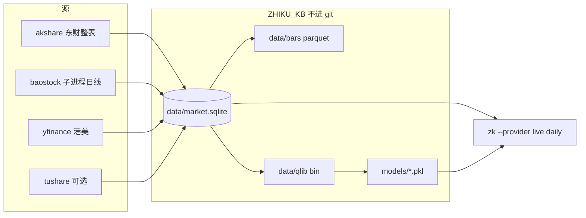

# zhiku 架构

胶水层，不重复造行情轮子。触发线是纯 Python 确定性路径；LLM 只出现在审核与新闻/宏观分析层。

```mermaid
flowchart TD
  ak[akshare / yfinance / baostock / tushare] --> sync[zk data sync]
  sync --> store[ZHIKU_KB/data SQLite+parquet]
  store --> liveUni[live 股票池 PIT 公告日]
  fixtures[Fixture YAML/CSV] --> fixUni[fixture 股票池]
  liveUni --> screens[选股公式]
  fixUni --> screens
  store --> prepare[zk factor prepare]
  prepare --> qlibDir[qlib bin]
  qlibDir --> train[zk factor train Alpha158+LGB]
  store --> train
  train --> models[ZHIKU_KB/models]
  models --> merge[公式分 + qlib 分]
  screens --> merge
  store --> backtest[回测闸门 真实价+成本+涨跌停]
  merge --> backtest
  backtest --> daily[zk daily]
  newsSrc[分级信源] --> news[新闻雷达]
  xWatch[X大V YAML名单] --> news
  macroSrc[日历 / FRED / 期货近似] --> macro[宏观锚点]
  news --> analyze[分析层 LLM或规则模板]
  macro --> analyze
  analyze --> reports[本地 markdown/JSON]
  macro --> windows[事件窗口]
  windows --> triggers[触发线 check/close]
  windows --> news
  triggers --> hitrate[zk review]
  macro --> hitrate
```

## 真实数据路径

启动：`zk data sync`（默认中证800、3 年、可 `--resume` / `--workers`）→ `zk factor prepare` → `zk factor train` → `zk --provider live daily`。fixture 模式仍读 `examples/fixtures`，不碰本地库。

## 包布局

- `zhiku/data`：`zk data sync` 增量落地到 `ZHIKU_KB/data`（列表、指数成分、前复权/不复权日线、三张报表+公告日、整表分红）。缺字段记 `MissingData`，不插值、不进 git。baostock 走独立进程，超时 kill，避免把登录连接挂死。
- `zhiku/screens`：Greenblatt / Piotroski / 低估值高分红 / 质量+动量，以及质量门槛。
- `zhiku/factors`：本地库 → qlib bin；Alpha158+LightGBM（无 pyqlib 则 pandas 特征+LGB）；没模型日报写「未训练」。
- `zhiku/backtest`：live 用本地库价格；成本/滑点；涨停不可买、跌停不可卖；公告日 PIT + 退市截断。
- `zhiku/news`：扫描、聚合、价量确认、**信源分级**、X 大V 跟踪、机会、分析层。
- `zhiku/events`：预期差、新颖度/半衰期（历史事件研究估算）、拥挤度、产业链 YAML/CSV+地缘传导、失效/时间止损、黑天鹅协议、PIT 财务、只追加决策日志。应急模式对触发线禁加。
- `zhiku/macro`：日历、预期差、事件剧本、传导链 YAML、事件窗口、利率近似。
- `zhiku/analyze.py`：共享分析卡片；无 key 降级并标「未做深度分析」。
- `zhiku/engine`：触发线与成长仓闸门；LLM 不进入。
- `zhiku/app`：Streamlit，含「今日舆情」「大V动态」「多空机会」「宏观与事件」。

## 信源分级

`news/grades.yaml` 定义 1–4 级别名、权重、官方 RSS。打分用 `grade_weight`；标签用 `tag_with_grades`：

- 「事实」需要一级，或二级转述且已回溯官方，或两条独立二级且非知情人士。
- 三级不能单独成事实，也不能单独进质量档；必须带 `InstitutionReview` 五个字段。
- 社交只做情绪。
- 「据知情人士」→「未经官方证实」，`followups` 跟踪确认/否认。
- X 大V：`newswire` 匹配一/二级才标事实；`institutional` 三级审查（持仓代码+利益关系）；`macro_fed` 在 FOMC 窗口加权；共振/反向风险；按账号命中率调权。

## 缺数据

`MissingData` 贯穿行情、预期、宏观实际值。没有一致预期就不算 surprise z，报告写「缺数据」，不插值、不编造。

## 隐私

`ZHIKU_KB` 指向仓库外知识库。示例持仓仅用于 demo。新闻/宏观对持仓只映射代码与行业，模板禁止输出 qty/cost。

## 时区

对外时间 Asia/Shanghai。宏观日历同时标注影响 A / H / 美哪个交易时段。美股价格保留美东交易日。

## 测试

默认 `pytest -m "not network"`。网络烟测需显式选中。分析层测试覆盖无 key 降级与字段完整性；新闻测试覆盖分级打分与三级审查字段；事件层覆盖缺预期、T+1 可执行、拥挤分组、传导 hop、到期「未兑现，撤」、应急清单、PIT 无前视。
